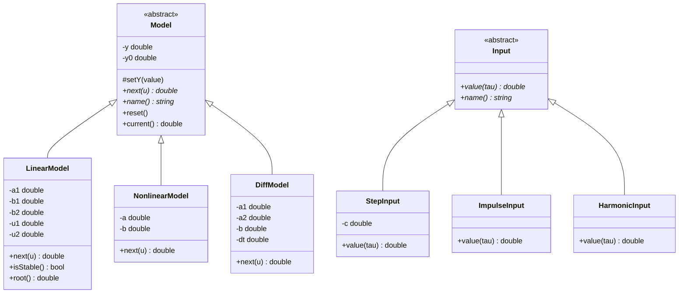
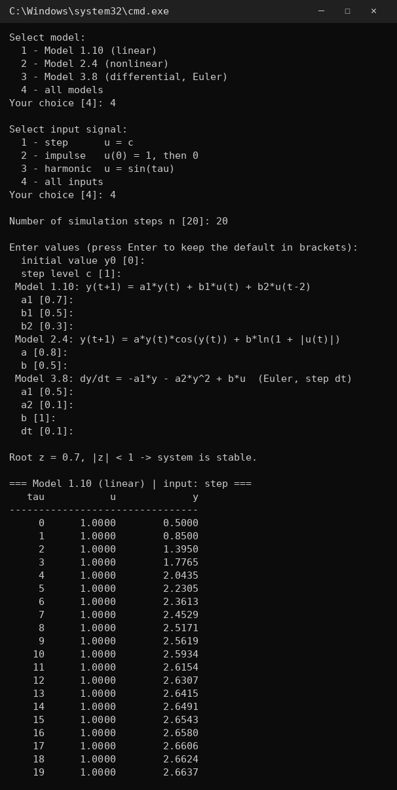
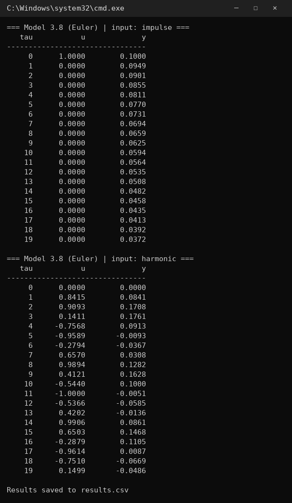
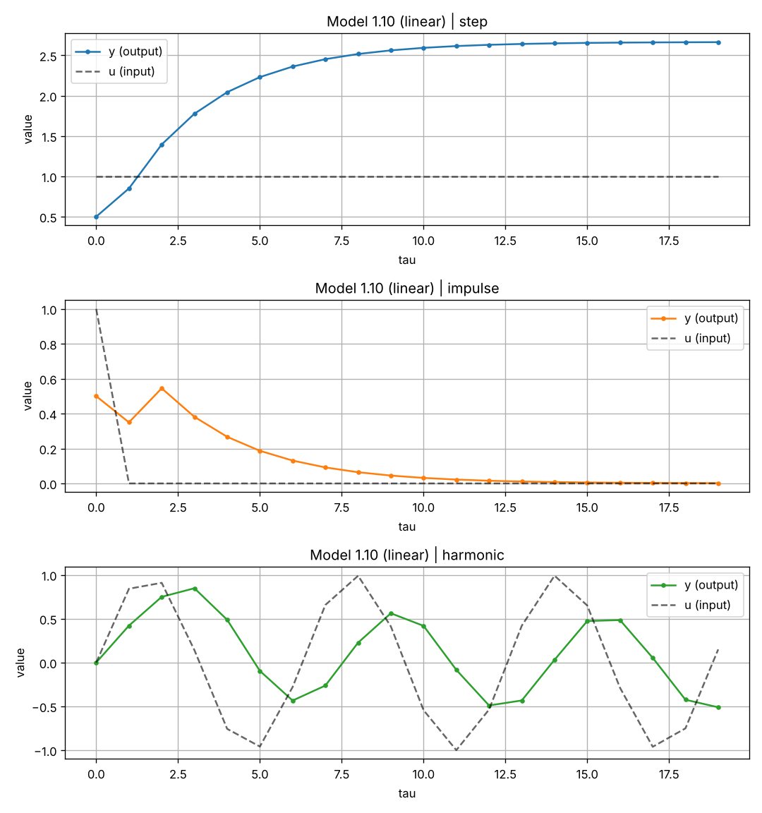
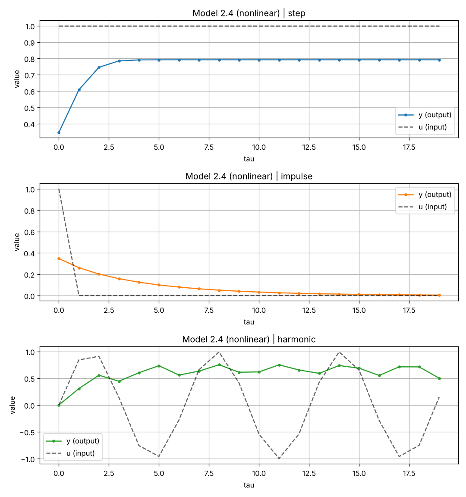
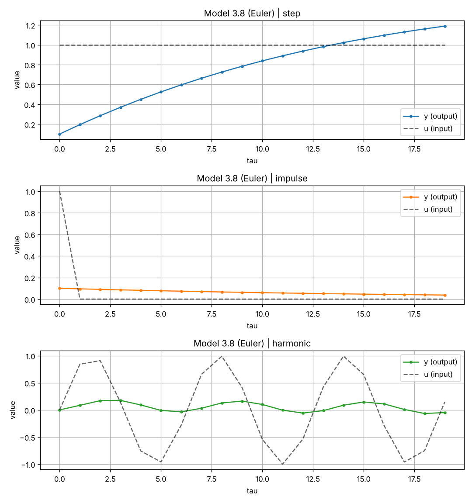
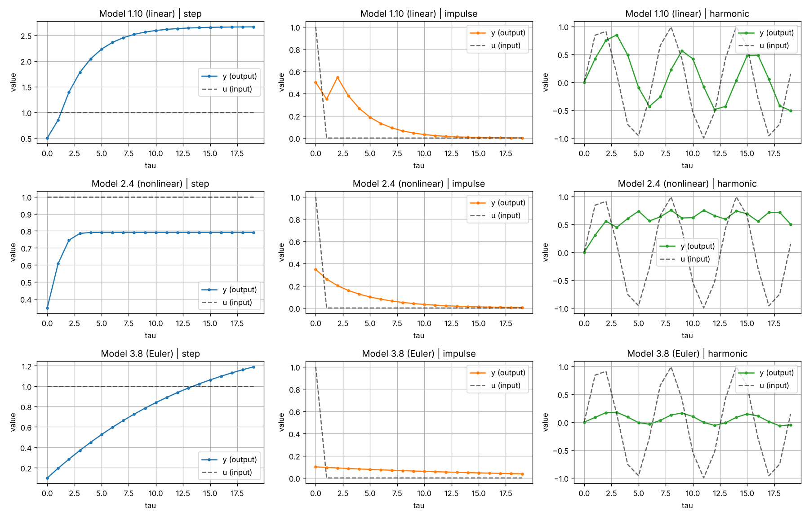

<p align="center">Министерство образования Республики Беларусь</p>
<p align="center">Учреждение образования</p>
<p align="center">«Брестский государственный технический университет»</p>
<p align="center">Кафедра ИИТ</p>
<br><br><br><br><br>
<p align="center"><b>Лабораторная работа №1</b></p>
<p align="center"><b>По дисциплине: «Общая теория интеллектуальных систем»</b></p>
<p align="center"><b>Тема: «Моделирование линейных, нелинейных и дифференциальных объектов»</b></p>
<br><br><br><br>
<p align="right">Выполнил:</p>
<p align="right">Студент 2 курса</p>
<p align="right">Группы ИИ-30</p>
<p align="right">Громов И. С.</p>
<p align="right">Проверил:</p>
<p align="right">Дворанинович Д. А.</p>
<br><br><br><br>
<p align="center">Брест 2026</p>

---

## Вариант 20

- Линейная модель: **Model 1.10**
- Нелинейная модель: **Model 2.4**
- Дифференциальное уравнение: **Model 3.8**

## Реализованные модели

| Блок | Модель | Тип | Название |
|:--:|:--:|:--:|---|
| 1 | 1.10 | линейная дискретная | Distributed Control Window Model |
| 2 | 2.4 | нелинейная дискретная | Logarithmic Multi-Variable Interaction |
| 3 | 3.8 | дифференциальное уравнение | Combined Linear-Quadratic Decay |

### Математические описания и параметры

- **Model 1.10**: `y(t+1) = a1*y(t) + b1*u(t) + b2*u(t-2)` (параметры по умолчанию: `a1 = 0.7`, `b1 = 0.5`, `b2 = 0.3`). Проверяется устойчивость по корню характеристического уравнения `z = a1` (`|a1| < 1`).
- **Model 2.4**: `y(t+1) = a*y(t)*cos(y(t)) + b*ln(1 + |u(t)|)` (параметры по умолчанию: `a = 0.8`, `b = 0.5`).
- **Model 3.8**: `dy/dt = -a1*y - a2*y^2 + b*u` (метод Эйлера: `y(t+1) = y(t) + dt*(-a1*y(t) - a2*y(t)^2 + b*u(t))`, параметры по умолчанию: `a1 = 0.5`, `a2 = 0.1`, `b = 1`, `dt = 0.1`).

Начальное значение `y0 = 0`, уровень ступеньки `c = 1` (все значения можно изменить при запуске программы).

## Входные воздействия

1. Ступенчатое: `u(t) = c`
2. Импульсное: `u(0) = 1`, `u(t > 0) = 0`
3. Гармоническое: `u(t) = sin(t)`

## ООП

Созданы абстрактные базовые классы `Model` и `Input`.

От класса `Model` наследуются конкретные модели:
- `LinearModel` — Model 1.10
- `NonlinearModel` — Model 2.4
- `DiffModel` — Model 3.8

От класса `Input` наследуются типы входных воздействий:
- `StepInput` — ступенчатое
- `ImpulseInput` — импульсное
- `HarmonicInput` — гармоническое

## UML Диаграмма классов


## Пример работы программы

### Сборка и запуск

Сборка осуществляется с помощью файла `build.bat`:

```bat
    @echo off
chcp 65001 > nul
cd /d "%~dp0"

echo ===== [1/4] CMake configure =====
cmake -S . -B build
if errorlevel 1 goto error

echo ===== [2/4] CMake build =====
cmake --build build --config Release
if errorlevel 1 goto error

set "EXE="
if exist "build\Release\ii03023_lab1.exe" set "EXE=build\Release\ii03023_lab1.exe"
if exist "build\Debug\ii03023_lab1.exe" set "EXE=build\Debug\ii03023_lab1.exe"
if exist "build\ii03023_lab1.exe" set "EXE=build\ii03023_lab1.exe"
if not defined EXE goto notfound
echo Program: %EXE%

:run
echo.
echo ===== [3/4] Run program =====
if exist results.csv del results.csv
"%EXE%"
if not exist results.csv goto noresults

echo.
echo ===== [4/4] Plot (Python + matplotlib) =====
python plot.py
goto ask

:noresults
echo results.csv was not created, skipping plot.

:ask
echo.
set "AGAIN="
set /p AGAIN="Run again with another model/input? (y/n): "
if /i "%AGAIN%"=="y" goto run
echo ===== DONE =====
exit /b 0

:notfound
echo Program ii03023_lab1.exe was not found after build.
echo Check that CMakeLists.txt contains: add_executable(ii03023_lab1 main.cpp models.h)
goto error

:error
echo BUILD FAILED
pause
exit /b 1
```
### Демонстрация исполняемого файла ii03023_lab1.exe:





### Примеры графиков переходных процессов

**Демонстрация Model 1.10 (линейная):**


**Демонстрация Model 2.4 (нелинейная):**


**Демоนстрация Model 3.8 (дифференциальное уравнение):**


**Сводный график:**


## Вывод

Программа:
- моделирует все три системы варианта;
- симулирует отклик на все три типа входных воздействий (ступенчатое, импульсное, гармоническое);
- позволяет задать количество шагов `n`;
- выводит результаты в табличном виде;
- сохраняет результаты в `results.csv`;
- визуализирует графики через Python/Matplotlib.