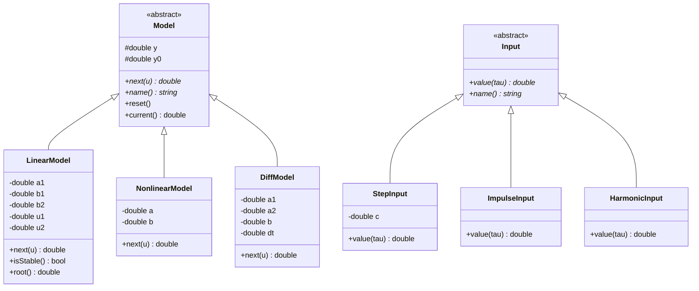
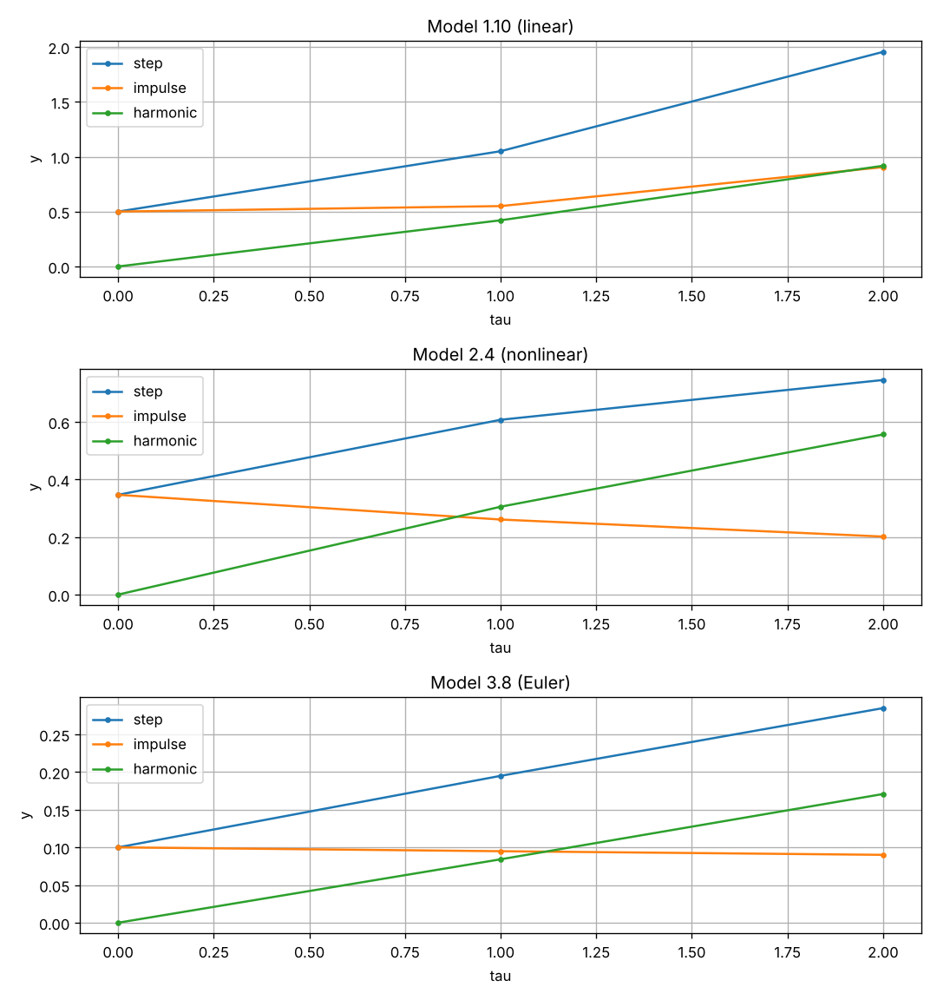

<p align="center">Министерство образования Республики Беларусь</p>
<p align="center">Учреждение образования</p>
<p align="center">«Брестский государственный технический университет»</p>
<p align="center">Кафедра ИИТ</p>
<br><br><br><br><br><br><br>
<p align="center">Лабораторная работа №1</p>
<p align="center">По дисциплине «Общая теория интеллектуальных систем»</p>
<p align="center">За 3 семестр</p>
<p align="center">Тема: «Моделирование линейных, нелинейных и дифференциальных объектов»</p>
<p align="center">Вариант 20</p>
<br><br><br><br><br>
<p align="right">Выполнил:</p>
<p align="right">Студент ФЭИС</p>
<p align="right">Группы ИИ-30</p>
<p align="right">Громов И.С.</p>
<p align="right">Проверил:</p>
<p align="right">Дворанинович Д.А.</p>
<br><br><br><br><br>
<p align="center">Брест 2026</p>

<br>

## 1. Цель работы

Освоить приемы математического моделирования, проектирования и программирования объектов различной природы на языке C++. Спроектировать программу, которая реализует три объекта (линейное уравнение, нелинейное и дифференциальное), выводит результат в табличном виде и строит графики уравнений.

## 2. Постановка задачи

В соответствии с вариантом 20 необходимо реализовать три математические модели:

| Блок | Модель | Тип | Название |
|:--:|:--:|:--:|---|
| 1 | 1.10 | Линейное | Distributed Control Window Model |
| 2 | 2.4 | Нелинейное | Logarithmic Multi-Variable Interaction |
| 3 | 3.8 | Дифференциальное | Combined Linear-Quadratic Decay |

Требования к реализации:
*   язык C++, принципы ООП; абстрактный базовый класс модели и виртуальные методы;
*   три вида входного воздействия:
    *   ступенчатое $u(\tau) = const$;
    *   импульсное $u(0) = 1, u(\tau>0) = 0$;
    *   гармоническое $u(\tau) = \sin(\tau)$;
*   ввод числа шагов $n$ и коэффициентов линейной модели во время работы программы;
*   табличный вывод результатов в консоль и сохранение в CSV-файл;
*   построение графиков результатов (Python + Matplotlib);
*   сборка проекта через CMake, запуск сборки и демонстрация — bat-файлом;
*   (Advanced) проверка устойчивости линейной модели перед началом симуляции.

## 3. Математическое описание

В программе реализованы три типа моделей: две дискретные и одна непрерывная. Все уравнения реализованы в соответствующих классах-наследниках.

### 3.1. Линейная дискретная модель (класс LinearModel)

$$y_{\tau+1} = a_1 \cdot y_{\tau} + b_1 \cdot u_{\tau} + b_2 \cdot u_{\tau-2}$$

Описание. Модель с «распределённым окном управления»: выход на следующем шаге зависит от текущего значения выхода, от текущего входа и от входа, поданного два шага назад. Коэффициент $a_1$ определяет инерционность объекта, $b_1$ — мгновенную реакцию на вход, $b_2$ — реакцию на запаздывающий на два шага сигнал. Для хранения $u_{\tau-1}$ и $u_{\tau-2}$ класс содержит собственную историю входа.

При ступенчатом входе $u = 1$ и устойчивой системе выход стремится к установившемуся значению:

$$y_{уст} = \frac{b_1 + b_2}{1 - a_1}$$

Анализ устойчивости. Однородная часть уравнения: $y_{\tau+1} = a_1 y_\tau$. Характеристическое уравнение $z - a_1 = 0$, его корень $z = a_1$. Система сходится, если корень лежит внутри единичной окружности на Z-плоскости: $|z| = |a_1| < 1$. Если пользователь вводит $|a_1| \ge 1$, программа выводит предупреждение о неустойчивости перед началом симуляции.

### 3.2. Нелинейная дискретная модель (класс NonlinearModel)

$$y_{\tau+1} = a \cdot y_{\tau} \cdot \cos(y_{\tau}) + b \cdot \ln(1 + |u_{\tau}|)$$

Описание. Модель содержит два нелинейных члена:
1. $a \cdot y_\tau \cos(y_\tau)$ — обратная связь, «коэффициент усиления» которой периодически меняется в зависимости от самого выхода.
2. $b \cdot \ln(1 + |u_\tau|)$ — логарифмическое преобразование входа: при малых $u$ реакция почти линейная, при больших — насыщается. Знак входа не учитывается, поэтому отрицательные и положительные полуволны гармонического сигнала действуют одинаково.

### 3.3. Дифференциальное уравнение (класс DiffModel)

В отличие от первых двух, этот объект является непрерывным и описывается дифференциальным уравнением первого порядка:

$$\frac{dy}{dt} = -a_1 \cdot y - a_2 \cdot y^2 + b \cdot u$$

Численное решение. Для интегрирования используется явный метод Эйлера с шагом $\Delta t$ (в коде — dt). Производная заменяется конечной разностью:

$$\frac{y_{\tau+1} - y_{\tau}}{\Delta t} \approx -a_1 y_\tau - a_2 y_\tau^2 + b u_\tau$$

Отсюда разностная схема, реализованная в методе next():

$$y_{\tau+1} = y_{\tau} + \Delta t \cdot (-a_1 y_\tau - a_2 y_\tau^2 + b u_\tau)$$

Физический смысл. Величина $y$ затухает одновременно линейно ($-a_1 y$) и квадратично ($-a_2 y^2$), а внешнее воздействие $b u$ её поддерживает. При постоянном входе выход плавно выходит на установившееся значение, при котором правая часть уравнения равна нулю.

Анализ шага $\Delta t$. Точность метода Эйлера зависит от величины шага: чем меньше $\Delta t$, тем ближе численное решение к истинному. При слишком большом шаге схема может стать неустойчивой даже для устойчивого исходного уравнения.

Параметры моделей в программе:

| Модель | Параметры |
|---|---|
| 1.10 | $a_1, b_1, b_2$ вводятся пользователем (по умолчанию 0.7, 0.5, 0.3) |
| 2.4 | $a = 0.8,\ b = 0.5$ |
| 3.8 | $a_1 = 0.5,\ a_2 = 0.1,\ b = 1,\ \Delta t = 0.1$ |

## 4. Архитектура программы

Программа построена на основе принципов объектно-ориентированного программирования. В центре архитектуры находится абстрактный базовый класс Model с чисто виртуальным методом next(), который рассчитывает следующий шаг симуляции. Основной цикл симуляции работает с объектами через ссылку на базовый класс, не зная их конкретного типа (полиморфизм).

Входные воздействия также построены как иерархия: абстрактный класс Input и три наследника — StepInput, ImpulseInput, HarmonicInput. Функция simulate() принимает любую модель и любой вход, поэтому каждая из трёх моделей прогоняется со всеми тремя видами воздействия.


*Рис. 1. Иерархия классов программы*

## 5. Сборка

Сборка проекта осуществляется с использованием системы CMake. Для автоматизации процесса и демонстрации сборки используется скрипт build.bat.

Скрипт выполняет следующие шаги:
1. Выполняет конфигурацию проекта (cmake -S . -B build).
2. Запускает компиляцию (cmake --build build --config Release).
3. Автоматически запускает полученный исполняемый файл.
4. Строит графики по файлу results.csv с помощью скрипта plot.py (Python + Matplotlib).

При ошибке на любом этапе скрипт выводит сообщение BUILD FAILED и останавливается.

## 6. Результаты моделирования

Программа запрашивает у пользователя количество шагов симуляции $n$ и коэффициенты $a_1, b_1, b_2$ линейной модели, затем проверяет её устойчивость.
В процессе работы программа:
1. Выводит в консоль таблицу с результатами (шаг $\tau$, вход $u$, выход $y$) для каждой из трёх моделей при каждом из трёх входных воздействий.
2. Сохраняет все результаты в файл results.csv.
3. Скрипт plot.py строит графики (plot.png): по одному графику на модель, на каждом — три кривые для разных входных воздействий.

Пример вывода (Model 1.10, ступенчатый вход, $n=10$, $a_1=0.7$, $b_1=0.5$, $b_2=0.3$):

| τ | u | y |
|---|---|---|
| 0 | 1.0000 | 0.5000 |
| 1 | 1.0000 | 0.8500 |
| 2 | 1.0000 | 1.3950 |
| 3 | 1.0000 | 1.7765 |
| 4 | 1.0000 | 2.0435 |
| 5 | 1.0000 | 2.2305 |
| 6 | 1.0000 | 2.3613 |
| 7 | 1.0000 | 2.4529 |
| 8 | 1.0000 | 2.5171 |
| 9 | 1.0000 | 2.5619 |

Выход стремится к установившемуся значению $\frac{0.5 + 0.3}{1 - 0.7} \approx 2.67$, что совпадает с аналитическим расчётом.

При вводе $a_1 = 1.1$ программа выводит предупреждение:
```
WARNING: root of characteristic equation z = 1.1, |z| >= 1 -> system is UNSTABLE (process will diverge)!
```



*Рис. 2. Графики переходных процессов трёх моделей при разных входных воздействиях*

## 7. Выводы

В ходе выполнения лабораторной работы была разработана программа на языке C++, моделирующая поведение трёх управляемых объектов (вариант 20).

Были применены принципы ООП: абстрактный базовый класс Model позволил реализовать единый цикл симуляции для трёх разных по своей природе уравнений (линейного, нелинейного и дифференциального), а иерархия классов Input — единообразно подавать на них разные входные воздействия.

Также реализованы ввод параметров во время выполнения, анализ устойчивости линейной модели по корню характеристического уравнения, сохранение данных в CSV-формат, визуализация с помощью Python/Matplotlib и автоматизация сборки через CMake и .bat-файл. Цель работы достигнута в полном объеме.

## 8. Приложение. Состав проекта

| Файл | Назначение |
|---|---|
| models.h | абстрактные классы Model и Input, модели 1.10, 2.4, 3.8, входные воздействия |
| main.cpp | точка входа, ввод параметров, проверка устойчивости, симуляция, вывод таблиц и CSV |
| plot.py | построение графиков по results.csv |
| CMakeLists.txt | правила сборки |
| build.bat | скрипт автоматической сборки, запуска и построения графиков |
